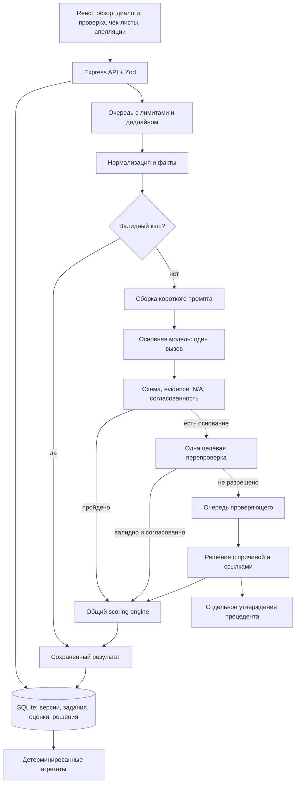

# Freedom CQA: объединённая архитектура продукта

Дата: 7 ноября 2026. Статус: проект решения для согласования; не описание уже внедрённых функций.

## 1. Задача и критерий успеха

Создать систему, в которой оценщик быстро получает проверяемую оценку диалога, проверяющий разрешает спор с сохранением истории, а руководитель видит причины повторяющихся проблем. Цели пользователя: повысить точность, снизить стоимость и ускорить обработку, объединив сильные стороны четырёх исследованных проектов.

«Лучше конкурентов» требует общего независимого набора и одинакового протокола замеров. Публичные проценты конкурентов на их собственных эталонах не являются сравнительным тестом. Успех первой поставки — проверяемые улучшения относительно нашего v4, а не обещанный процент точности.

Предлагаемые решения автора документа: сохранить TypeScript/Express/React, строить модульный монолит, начинать с одного AI-вызова, направлять спорные результаты на выборочную проверку. Пользователь поручил объединить сильные стороны; конкретные пороги и схема реализации ниже пока являются предложением.

## 2. Исходное состояние: что сохраняем

Проверено по исходникам рабочего проекта:

| Область   | Сейчас                                                              | Изменение                                                                      |
| --------- | ------------------------------------------------------------------- | ------------------------------------------------------------------------------ |
| Контракты | Zod, `shared/contracts.ts`                                          | Версионируемые расширения, совместимое чтение старых записей                   |
| Backend   | Express 5, TypeScript, Node, SQLite WAL                             | Тот же стек; отделить политику оценивания от выполнения заданий                |
| AI        | Адаптеры Gemini и OpenAI-compatible; рабочий промпт v4              | Экспериментальный facts-first профиль за отдельным идентификатором             |
| Проверки  | Schema → допустимые ответы/баллы → evidence                         | Добавить проверяемые факты и проверку противоречий                             |
| Очередь   | В одном процессе, concurrency=2, состояния persisted в SQLite       | Общий лимит вызовов, длительности и стоимости; явная история стадий            |
| Повторы   | Один repair и до двух transient retries                             | Сохранить v4; новая политика не складывает бесконечно repair, retry и verifier |
| Кэш       | Диалог/хэш, версия чек-листа, provider/model/config, prompt         | Добавить версии facts, validator, routing, маскирования и прецедентов          |
| Апелляции | Серверное хранение, исходный/итоговый ответ, предпросмотр пересчёта | Сохранить; добавить утверждение прецедентов отдельным действием                |
| UI        | React, три основных раздела, переходы к доказательствам             | Обзор, очередь проверки, сравнение прогонов, диагностика                       |
| Звонки    | Audio controls и переход к тексту                                   | Связать выбранную реплику со временем аудио только при надёжном сопоставлении  |
| Экспорт   | Строгий формат результатов организаторов                            | Сохранить формат; новые внутренние поля не протекают в файл                    |

Предыдущие изменения QA и отчёты остаются отдельными. V5/V6 не продвигаются в рабочий профиль: последний эксперимент не доказал общего улучшения. См. `docs/PROMPT_V6_FRESH.md`.

## 3. Подходы и выбранное направление

1. **Перенос чужого приложения целиком.** Получаем часть UI быстрее, но теряем наши контракты, валидаторы, серверные апелляции и историю; добавляются разные backend-стеки и неоднозначность лицензий. Не подходит.
2. **Модульное развитие нашего приложения — рекомендуемое направление.** Реализуем полезные механизмы в существующих слоях, сохраняем проверенную математику, сравниваем AI-изменения с v4. Результаты поставляются небольшими завершёнными частями.
3. **Микросервисы, собственный GPU и полная клиентская поддержка сразу.** Увеличивают инфраструктуру и область проверки, не решая сами по себе неоднозначность критериев. Отложены до измеренной нагрузки и реального запроса на поддержку клиентов.

Объединяются возможности, а не четыре несовместимых runtime. PostgreSQL/Redis понадобятся при нескольких API/worker-процессах; до этого SQLite и один владелец очереди остаются рабочим вариантом.

## 4. Самостоятельная реализация

Все новые модули реализуются в текущем проекте по контрактам ниже. В продуктовых материалах описываются собственные возможности и измеренные результаты. Лицензионные уведомления установленных зависимостей сохраняются.

## 5. Целевая архитектура

`EvaluationService` управляет заданием; `EvaluationPolicy` решает, когда нужны repair/verifier/человек; providers только вызывают модель. Валидатор и scoring не знают SDK и не делают сетевых вызовов.

## 6. AI-пайплайн и правила доказательств

### 6.1 Нормализация и факты

Нормализатор сохраняет исходный порядок, стабильные message IDs, source index, роль, текст и исходную временную метку. Нельзя переставлять сообщения по ненадёжному timestamp. Экспорт переводит ID в 1-based номер по исходному массиву.

`ConversationFacts` содержит версию extractor, transcriptHash, список операторских сообщений, первый/последний операторский turn, интервалы времени и системные события. Каждое событие имеет `messageIds`, `source: structured | heuristic | model`, `status: observed | unknown`.

Точный порядок и роли — факты. Найденная регулярным выражением фраза о верификации/прощании — подсказка, не доказанный бизнес-факт. Текст сообщения с ролью system остаётся недоверенным содержимым; структурированное событие считается доверенным только от проверенного импортёра.

Отсутствующие/невалидные/несопоставимые timestamps дают null и диагностическую причину; отрицательные интервалы не превращаются в ноль. Метрики первой реакции показываются отдельно и не меняют баллы без соответствующего правила чек-листа.

### 6.2 Один основной вызов

Рабочий v4 остаётся baseline. Кандидат `facts-first-v1` возвращает в одном запросе:

- небольшой набор событий, нужных действующим критериям, с message IDs;
- один ответ на каждый критерий;
- короткое обоснование, ссылки, проверенный участок и причину N/A.

Не запрашиваем длинное рассуждение и пересказ всего диалога. Вычислимые факты не генерируются повторно. Промпт собирается из версии чек-листа, facts и при необходимости максимум двух утверждённых прецедентов в пределах общего лимита контекста.

Контекст всего диалога сохраняется: слова клиента, бота и системы нужны, чтобы судить об операторе. Оптимизация не удаляет их вслепую. Перевод KZ/EN в RU перед оценкой не вводится как обязательная стадия.

### 6.3 Контракт доказательств

| Решение                                                    | Требование                                                                                                         |
| ---------------------------------------------------------- | ------------------------------------------------------------------------------------------------------------------ |
| Положительное стандартное решение, включая частичную шкалу | Прямая ссылка на релевантную реплику оператора; для идентификации допустимо подходящее системное подтверждение     |
| false или числовой 0                                       | Проверенный участок, где ожидалось действие; объяснение конкретного невыполненного условия                         |
| N/A                                                        | `allowNA=true`, выполнено именно `naRule`, непустой `naReason`, проверенный участок; N/A не заменяет неизвестность |
| Любое не-N/A                                               | `naReason=null`                                                                                                    |
| gross=true                                                 | Положительное доказательство нарушения и подтверждение человеком до применения последствий к сотруднику            |
| gross=false                                                | Проверены все операторские реплики; отсутствие совпадения с regex не достаточно                                    |
| Пользовательский критерий                                  | Доказательства соответствуют роли и наблюдаемости, заданным в его определении                                      |

Цитаты UI получает из сохранённого оригинала по ID. Если модель возвращает цитату, проверяем её совпадение; не принимаем красивое объяснение за доказательство. Валидный ID доказывает существование реплики, но не семантическую правильность решения.

Неизвестность отделена от N/A: если требуемую информацию установить нельзя, а `naRule` не выполняется, результат направляется на проверку. Нельзя автоматически штрафовать оператора за дефект записи или выдавать произвольное N/A.

Для кандидата используется отдельный `CriterionAssessment`: `resolved` содержит существующий `CriterionAnswer`; `unresolved` содержит criterionId, reasonCode, explanation и checkedSpanMessageIds, но не содержит value/баллы. Например, `reasonCode=insufficient_recording`. На каждый критерий требуется ровно один assessment, а не обязательно выдуманный допустимый ответ. Конвертация в массив `CriterionAnswer` возможна только если все assessments resolved. Хотя бы один unresolved означает отсутствие общего preliminary/final score; подтверждённые локальные ответы можно показать отдельно без нормализации по неполному набору. V4 продолжает использовать прежнюю JSON-схему.

Проверяющий вправе оставить вопрос открытым (`defer` с причиной). Это не N/A и не завершение: review item остаётся открытым, экспорт остаётся error. После получения данных/уточнения правила человек может заполнить недостающий ответ; при изменении транскрипта или правила нужна новая версия оценки, а не редактирование старого источника.

### 6.4 Проверка согласованности и повторные вызовы

Примеры сигналов: модель ссылается на чужую роль; событие идёт после действия, хотя обоснование утверждает обратное; N/A противоречит указанным фактам; один критерий утверждает отсутствие раскрытия данных, другой — его наличие. Правила стандартных критериев действуют только при совпадении их semantic fingerprint. Изменённый или новый критерий получает общую валидацию, а не старую скрытую логику.

Два разных механизма:

1. **Repair:** ответ не соответствует контракту. Один запрос на восстановление полного ответа, чтобы не принимать обрезанную структуру за завершённую оценку.
2. **Verifier:** ответ валиден, но обнаружен риск ошибки. Один независимый запрос по спорным и зависимым критериям с исходным диалогом. Сначала формирует свой ответ без показа первого вердикта; сервер сравнивает ответы после генерации.

Первый вариант сохраняется неизменно. Два совпавших ответа не обозначаются как «100% уверенности». При расхождении — проверяющий, без придуманного большинства из двух голосов. Структурно корректный, но семантически спорный ответ получает preliminary score и явно видимый review state; невалидный результат не получает итогового балла.

Терминальные переходы новой политики:

| Результат                                                                                                  | Состояние legacy evaluation                                                   | Черновой результат                                          | Очередь                                                     |
| ---------------------------------------------------------------------------------------------------------- | ----------------------------------------------------------------------------- | ----------------------------------------------------------- | ----------------------------------------------------------- |
| Primary/repair валиден, все criteria resolved, сигналов нет                                                | completed                                                                     | Итог опубликован                                            | Не обязательна; возможен отдельный выборочный аудит         |
| Контракт нарушен после разрешённого repair                                                                 | failed / INVALID_MODEL_OUTPUT                                                 | Raw/ошибки только в runs, общего балла нет                  | Техническая проверка, не автоматическое принятие            |
| Есть unresolved                                                                                            | failed / REVIEW_REQUIRED                                                      | Assessments в runs, общего балла нет                        | Обязательна                                                 |
| Verifier совпал, обе версии валидны, повторная consistency-проверка не нашла исходного/нового противоречия | completed, кроме gross=true                                                   | Итог опубликован                                            | Для gross=true обязательное подтверждение человека          |
| Ответы совпали, но противоречие осталось                                                                   | failed / REVIEW_REQUIRED                                                      | Preliminary только при полном валидном наборе               | Обязательна                                                 |
| Ответы различаются                                                                                         | failed / REVIEW_REQUIRED                                                      | Primary сохраняется в runs; никакого автоматического выбора | Обязательна                                                 |
| Verifier невалиден/недоступен, закончился бюджет или дедлайн                                               | failed / REVIEW_REQUIRED, если есть валидный primary; иначе failed с причиной | Валидный primary только в runs                              | Обязательна при наличии кандидата; иначе техническая ошибка |
| Primary недоступен после transient retry                                                                   | failed с причиной provider                                                    | Балла нет                                                   | Техническая очередь; повтор по явному действию              |
| Человек разрешил все обязательные вопросы, весь набор проходит валидаторы                                  | completed, reviewState=resolved                                               | Публикуются effective answers и final score                 | Закрыта                                                     |

Снятие сигнала не определяется только совпадением value: facts и evidence проверяются заново. Для gross=true даже два согласных ответа остаются предварительными до решения человека. Проверка подтверждает или изменяет ответ; нельзя кнопкой «принять всё» пропустить невалидные ссылки.

В новой политике максимум четыре фактических обращения к провайдерам на задание: primary + до одного repair + до одного verifier + один общий transient retry. Это общий счётчик, а не лимит для каждой стадии. Если лимит/дедлайн исчерпан, запуска новой стадии нет. Все попытки, включая неуспешные, учитываются в расходах. При отказе primary без валидного результата задание failed; при отказе verifier валидный primary сохраняется как предварительный с обязательной проверкой.

Экспериментальный общий дедлайн — 120 секунд от старта обработки, включая backoff; бюджет вызова — оставшееся время. Значения конфигурируемы и входят в policy snapshot. Это проектное ограничение, не обещанная задержка.

### 6.5 Маршрутизация моделей

Не выбираем победителя по названию модели или чужим процентам. В первой реализации основной профиль — текущий настроенный Gemini, verifier — явно сконфигурированный совместимый адаптер; без его настройки используется ручная очередь. Внешний fallback не происходит скрытно.

Candidate model/config/prompt фиксируется на всё задание. Смена настройки не изменяет уже запущенные оценки. Выбор provider, model, endpoint, регион и разрешённый маршрут данных хранится в серверной конфигурации; секреты не попадают в API/UI.

## 7. Кэш, стоимость и очередь

Ключ AI-оценки: conversation identity + transcript hash + полный checklist fingerprint + provider/model/config + prompt + facts extractor + validator + policy + privacy policy + precedent snapshot. Смена любого семантически значимого компонента инвалидирует ответ. Не делаем общий кэш разных организаций/прав доступа.

Повторный запрос с тем же ключом во время выполнения ссылается на существующее задание. Кэш-хит создаёт receipt с `reusedEvaluationId`: историческая цена генерации и цена текущего повторного использования показываются отдельно.

Стоимость хранится как `knownCostUsd`, `unknownUsageAttempts`, `pricingVersion`, `costKind: provider_reported | estimated | unknown`. Неизвестная стоимость не равна нулю. Разделяем input/output/thinking/cached tokens по семантике конкретного адаптера и не считаем reasoning дважды.

Для hard budget нужен верхний резерв по размеру запроса, max output и тарифу; неизвестный тариф запрещает автоматический вызов в режиме жёсткого бюджета. Неизвестный расход после ошибки оставляет резерв занятым до сверки. Лимиты per-job и per-batch атомарны, общий concurrency учитывает primary/repair/verifier. Сбой не освобождает неизвестный расход как будто он бесплатный.

Один процесс владеет SQLite-очередью. Несколько worker-процессов до реализации атомарного claim/lease запрещены. После перезапуска interrupted сохраняется в истории; внешнее exactly-once выполнение не обещается. Повторное выполнение создаёт новую попытку и может стоить денег.

PostgreSQL + worker queue — отдельная поставка при необходимости нескольких экземпляров. Переход включает lease, idempotency, retry/backoff и проверку отказа worker; замена БД сама по себе не повышает точность.

## 8. Чек-листы и повторная оценка

Добавить profile с каналами, семейством checklistId и ссылкой на активную неизменяемую версию. Старый default остаётся legacy-профилем, миграция не меняет старые оценки и не создаёт новую трактовку звонков молча.

Редактор показывает diff: определения, типы, N/A, шкалы, веса, секции. Сохранение создаёт версию, активация — отдельное явное действие. Старые результаты доступны с пометкой «по предыдущей версии».

По умолчанию изменение чек-листа требует новой полной оценки. Оптимизация «только изменённые критерии» — отдельный режим после теста эквивалентности: изменённый критерий + dependency closure. Неизвестные зависимости пользовательского критерия инвалидируют весь ответ. Изменение общих правил, прецедентов или схемы также инвалидирует весь ответ.

Чистая смена весов допускает мгновенный what-if preview из сохранённых ответов. Он подписан как пересчёт и не становится новой AI-оценкой. Официальный экспорт сохраняет требования организаторов к переоценке версии.

Помощник формулировки критерия предлагает наблюдаемость, различимые ступени, N/A и предупреждения о пересечении. Отправляет только текст критериев. Ничего не активирует и не меняет веса самостоятельно; применяется как черновик редактора после выбора человека.

## 9. Экранная модель

| Раздел         | Главная задача и действия                                                              | Важные состояния                                                     |
| -------------- | -------------------------------------------------------------------------------------- | -------------------------------------------------------------------- |
| `/overview`    | Покрытие оценкой, грубые нарушения, очередь проверки, причины потерь → фильтр диалогов | Нет данных; часть не оценена; устаревшая версия; неизвестные расходы |
| `/dialogs`     | Поиск, язык/канал/версия, импорт, пакетная оценка                                      | queued/running/failed; reviewed/preliminary; версия устарела         |
| `/dialogs/:id` | Текст слева, причины снижения справа, критерии и доказательства ниже                   | Текст есть, аудио недоступно; review required; несколько прогонов    |
| `/review`      | Сначала gross и противоречия, затем выборочный аудит обычных результатов               | Конфликт двух решений, уже рассмотрено другим проверяющим            |
| `/checklists`  | Профили чатов/звонков, draft, diff и публикация новой версии                           | Dirty draft; неправильная шкала; несовместимый канал                 |
| `/appeals`     | Спор, фрагмент, исходный ответ → решение → новый итог                                  | Pending/resolved; stale decision; повторная отправка                 |
| `/operations`  | Задания, вызовы, лимиты, ошибки, расходы и конфигурации                                | Provider outage; quota; неизвестный usage; остановленный job         |

В карточке порядок: предварительный/финальный статус → итог и версия → причины снижения → доказательства → остальные критерии → техническая диагностика по раскрытию. Изменение ответа показывает delta до сохранения; исходная оценка не перезаписывается.

Звонок: компактные полосы реплик по ролям и метки доказательств. Это временная шкала сообщений, не выдуманная звуковая waveform. Клик переводит к тексту; seek в плеере доступен только при известном audio offset. ISO timestamps, MM:SS и паузы записи требуют явного преобразования; при неизвестной привязке показываем «Время в записи не сопоставлено». Автовоспроизведение не включаем.

Доступность: системная/светлая/тёмная тема, увеличенный текст, цвет + текст/значок для статусов, фокус, клавиатура и reduced motion. Стрелки не перехватываются в input/textarea/select; настройки вида можно хранить локально, оценки и решения — только на сервере. Озвучивание и полноценная локализация RU/KZ/EN — последующий этап; поддержка языка диалога не означает уже готовые три языка интерфейса.

## 10. Данные, API и совместимость

`EvaluationStatus` остаётся queued/running/completed/failed. Качество результата хранится отдельно: `reviewState: not_required | required | resolved`, `reviewReasons[]`. Не добавляем review_required в существующий SQL CHECK статуса. Для совместимости обязательная проверка представляется как failed с `error.code=REVIEW_REQUIRED`; новый UI отображает её как «Нужна проверка», а не как provider failure. Непринятые assessments/preliminary score живут только в `evaluation_runs` с `isPreliminary=true`. Они не попадают в `evaluations.finalScore/effectiveAnswers` и не видны старому exporter как completed. Поэтому откат не превращает предварительный ответ в финальный.

Новые сущности:

- `evaluation_policy_snapshots`: immutable routing/budget/privacy/model settings.
- `evaluation_runs`: immutable ответы primary/repair/verifier, факты, ссылки, validation report; связи на evaluation/attempt.
- `review_items` и `review_decisions`: состояние очереди, ожидаемая revision, решение, причина, evidence; optimistic concurrency, атомарный commit.
- `generation_receipts` и `usage_ledger`: каждый provider call/кэш-хит, резервы, известная стоимость и неизвестность.
- `checklist_profiles` и `profile_activations`: каналы и активные версии.
- `precedents`: утверждённые обезличенные решения с fingerprint критерия и источником.
- `audit_events`: actor, действие, entity ID, timestamp, outcome; без сырых транскриптов/ключей.

Один `DecisionService` применяет решения из обеих точек входа: апелляции и review queue. Общий `evaluationRevision` проверяется транзакционно; решение по устаревшей revision получает 409 и требует перечитать результат. Оба маршрута пишут один append-only журнал решений; `appeals`/`review_items` связываются с его decisionId. Последовательность определяется revision, а не временем браузера. Изменяются только затронутые ответы, весь набор пересчитывается тем же scoring engine. Для изменённого ответа сохраняются новые evidence IDs, причина, actor, source decision и before/after; старые model runs и original answers неизменны. Связанные открытые задачи не закрываются молча: помечаются superseded либо требуют перечитать новую revision.

Если полноценного валидного исходного ответа модели не было, originalAnswers остаётся пустым, originalScore=null; частичные assessments сохраняются в runs. После полного человеческого решения `evaluationSource=human_review`, effectiveAnswers/finalScore публикуются только после полной валидации. Интерфейс и новый exporter не приписывают ручное решение модели. Обычная апелляция к уже завершённой оценке не делает исходную оценку preliminary: пока спор открыт, UI/export явно показывают pending appeal; manifest сохраняет, какая версия использована. Обязательная системная проверка и добровольная апелляция — разные причины очереди.

Существующие payload расширяются через versioned decoder, новые поля у старых записей не предполагаются. Старые completed читаются как legacy, без выдуманных фактов/цен. Миграции через schema_migrations и транзакции, сначала резервная копия. Поддерживаемый rollback — отключение candidate/UI flags на новой версии приложения. Старый binary допустим только в read-only режиме с отключённым экспортом и решением апелляций: он не понимает новую provenance/revision. Возможность destructive downgrade не обещается; схема миграций additive.

Предлагаемые additive endpoints:

| API                                            | Назначение                                                        |
| ---------------------------------------------- | ----------------------------------------------------------------- |
| `GET /api/overview`                            | Агрегаты с фильтрами, coverage и определением выбранной оценки    |
| `GET /api/evaluations/:id/diagnostics`         | Стадии, версии, usage/cost completeness, review reasons           |
| `GET /api/evaluation-comparisons?left=&right=` | Diff ответов и баллов одного transcriptHash; несовместимость явно |
| `GET /api/review-items`                        | Очередь с pagination и фильтрами                                  |
| `POST /api/review-items/:id/decisions`         | Решение с expectedRevision и idempotency key                      |
| `GET /api/checklist-profiles`                  | Профили и activeVersionId                                         |
| `POST /api/checklist-profiles/:id/activations` | Активация существующей версии с проверкой канала                  |
| `POST /api/checklist-drafts/analyze`           | Необязательное AI-предложение к черновику, отдельный бюджет       |
| `POST /api/precedents`                         | Явное утверждение решения как примера                             |

Новые экранные маршруты одновременно добавляются в `navigation.ts` и Express SPA fallback; direct URL, refresh и back должны работать. Старые ссылки с evaluation/appeal/message сохраняются. Экспорт не выбирает незаметно «самую высокую» оценку: фиксируется manifest с ID диалогов, версией и выбранными evaluation IDs. Preliminary/неразрешённые результаты по умолчанию блокируют успешный экспорт; ошибка записывается в допустимой форме, а не подменяется нулём.

## 11. Аналитика, прецеденты и границы доверия

Обзор агрегирует одну выбранную валидную оценку на диалог и версию, не все повторные прогоны. Отдельно показывает AI-original и reviewer-final. Failed/неоценённые не входят в средний балл как нули; рядом всегда denominator и coverage. Если часть данных отсутствует, доля потерь и средний балл подписаны как неполные.

Потеря по критерию = `maxPoints - points` после N/A-нормализации; она может превышать исходный вес. AI-аналитик получает определение показателя и агрегаты, чтобы не объявлять это арифметической ошибкой. Агрегаты считает SQL/TypeScript, модель только объясняет и ссылается на разрешённые срезы. AI-аналитик не запускается при каждом открытии страницы.

Риск повторного обращения/ухода — предположение с цитатой, не вероятность и не факт о человеке. Не включается в QA score. Для первого релиза достаточно тем и статуса решения; эти данные можно получать из уже сохранённого фактического резюме, без обязательного отдельного вызова на каждый диалог.

Прецедент утверждается экспертом отдельно от апелляции; выбирается по fingerprint, каналу и языку, максимум два. Исключаются сам диалог, его дубликаты/переводные близнецы и весь evaluation holdout. Не прошедший модерацию текст не становится инструкцией. Изменение правила инвалидирует прежние примеры. Снимок ID/hash сохраняется в оценке.

Внешняя база знаний вводится только при наличии утверждённых источников с версиями. Прежние ответы операторов не считаются достоверной базой. Наличие противоречия с неизвестным регламентом не выдумывается.

## 12. Демо и развёртывание с реальными данными

В текущем приложении нет полноценной аутентификации. Переключатель роли в UI не является контролем доступа. Демо остаётся с явной пометкой; до реальных клиентских данных нужны серверные reviewer/admin permissions, scope организации, журнал доступа, закрытое хранение аудио и ограничения экспорта.

Псевдонимизация должна сохранять тип данных и роль, чтобы не ломать критерии идентификации/раскрытия. Политика маскирования и разрешённый provider входят в snapshot/cache key. UI показывает фактический endpoint/регион как настроенные сведения; не пишет «данные не покидают контур» только из-за использования открытой модели. Новая облачная модель не получает данные автоматически при отказе основной.

Живой клиентский чат, голосовой ассистент, D365 и обучение собственной модели — расширения после завершения QA-ядра. Для чата потребуется отдельная утверждённая база знаний, очередь оператора с реальным ожиданием, CSAT и общий QA после завершения; в этой поставке их не смешиваем с оценщиком.

## 13. Как проверяем точность, стоимость и скорость

1. Зафиксировать v4, candidate и config. Эталон утверждают независимые люди; спорные случаи проходят арбитраж до просмотра предсказаний. Если экспертов пока нет, AI-разметка честно называется предварительной и не даёт оснований объявить победу.
2. Разделять примеры по семействам/переводным близнецам. Один и тот же сюжет на RU/KZ/EN не попадает одновременно в prompt tuning и holdout. Минимум для пилота — 30 новых размеченных диалогов, с покрытием трёх языков и звонков; это предварительный тест, не доказательство универсального превосходства.
3. Отдельный набор boundary cases: client refused identification, correct next step, late clarification, abrupt ending, incomplete recording, multiple requests, custom criterion, gross false/true, quoted insults, prompt injection. Все ID исходные.
4. Сравнение на одинаковом transcript/checklist: baseline v4, facts-first с одним вызовом, facts-first с выборочной проверкой. Rotating order, одинаковая конкуренция и минимум два повтора для оценки нестабильности. Holdout не используется для повторной настройки.
5. Метрики: strict match по критерию/языку/каналу, precision/recall N/A и gross с числителями/знаменателями, MAE итогового балла, доля структурных ошибок, end-to-end failures, repair/verifier/review rate, число вызовов, известная стоимость и unknown usage, p50/p95 очереди/обработки/end-to-end, flip rate.
6. Ошибки выполнения входят в общий показатель качества как неуспех; дополнительно отчёт на успешных. Human review может повышать качество, но coverage автоматически завершённых и время человека измеряются отдельно. Не заявляем удешевление, просто переложив работу человеку.

Предлагаемый gate пилота: candidate не ухудшает end-to-end strict match, не добавляет пропуски gross и ложные обвинения на зафиксированных случаях; полная стоимость и p95 не выше baseline при сопоставимой нагрузке. Если качество выше ценой скорости/цены, показываем tradeoff, не выдаём его за победу по всем трём. При неизвестном usage вывод о полной экономии откладывается. Малый набор и доверительные интервалы по диалогам указываются явно.

Целевые ориентиры после пилота, не текущие обещания: валидный результат или явная очередь проверки для каждого запроса; 100% ссылок на существующие исходные сообщения; не более четырёх вызовов в новой политике; уменьшение времени ручного разбора минимум на 20% в парном сценарном тесте.

## 14. Порядок реализации и готовность этапов

| Этап                             | Изменения                                                             | Критерий готовности                                                                      |
| -------------------------------- | --------------------------------------------------------------------- | ---------------------------------------------------------------------------------------- |
| A. Наблюдаемость                 | Versioned diagnostics, cost ledger, cache receipt, сравнение прогонов | Неизвестная стоимость сохраняется; цена не дублируется при cache hit; тесты retry/repair |
| B. Проверяемые факты             | facts extractor, контракт кандидата, semantic validation              | RU/KZ/EN и плохие timestamps; schema parity local/provider; v4 неизменён                 |
| C. Выборочная проверка           | Policy, общий бюджет, verifier, review queue                          | Лимиты и остановка; несогласие не превращается в уверенный ответ; серверные решения      |
| D. Рабочий интерфейс             | Обзор, причины снижения, diagnostics, compare, timeline               | Весь сценарий без потери контекста, клавиатура, 360/768/1440px, direct URLs              |
| E. Версии и обучение на решениях | Канальные профили, diff, stale, moderated precedents                  | Никакой утечки holdout; старые оценки воспроизводимы; условный кэш корректен             |
| F. Бизнес-пилот                  | Срезы причин/тем, необязательный AI-аналитик, права доступа           | Все числа воспроизводятся без LLM; реальные данные доступны только нужным ролям          |

A–E образуют целевую поставку QA. F — следующая поставка; клиентский AIM и микросервисы — отдельные расширения. Каждый этап добавляется за feature flag, фиксирует собственные acceptance tests и оставляет рабочий v4 доступным. Пользовательское «объединить» не означает замены всего проекта одним большим merge.

## 15. Карта модулей для реализации

| Путь                                                                                 | Ответственность                                                 |
| ------------------------------------------------------------------------------------ | --------------------------------------------------------------- |
| `shared/contracts.ts` + новые `shared/evaluation-policy.ts`, `shared/diagnostics.ts` | Versioned DTO, budget, review, provenance                       |
| `server/src/evaluations/facts.ts`                                                    | Детерминированный extractor фактов из структуры диалога         |
| `server/src/evaluations/policy.ts`                                                   | Решения о стадиях, лимитах и направлении на проверку            |
| `server/src/evaluations/consistency.ts`                                              | Проверки фактов/ответов и dependency graph                      |
| `server/src/evaluations/service.ts`                                                  | Существующая очередь + выполнение policy без второй очереди     |
| `server/src/evaluations/provider.ts`                                                 | Типизированные primary/verifier inputs и usage semantics        |
| `server/src/evaluations/prompt.ts`                                                   | v4 сохраняется; candidate builder отдельно, явный promptVersion |
| `server/src/evaluations/scoring.ts`, `evidence.ts`                                   | Общие чистые функции, усиление без ослабления правил            |
| `server/src/usage/`, `server/src/review/`, `server/src/analytics/`                   | Ledger, review workflow, детерминированные агрегаты             |
| `server/src/checklists/`, `server/src/precedents/`                                   | Profiles, activation/diff, утверждённые примеры                 |
| `server/src/db.ts` + `server/src/migrations/`                                        | Совместимые миграции и ограничения                              |
| `web/src/EvaluationPanel.tsx`, `EvaluationAppeals.tsx`, `Transcript.tsx`             | Развитие текущих экранов вместо параллельных реализаций         |
| `web/src/OverviewPage.tsx`, `ReviewQueuePage.tsx`, `EvaluationComparison.tsx`        | Новые рабочие сценарии                                          |
| `qa/gemini/` и отдельный общий eval harness                                          | Замороженные версии, фикстуры, отчёты сравнения                 |

Исполнителю оставлены мелкие решения: внутреннее разбиение файлов, названия CSS-классов, вид графиков из существующих SVG-компонентов. Не оставлены на усмотрение: смысл N/A, политика невалидных ответов, цена неизвестного usage, скрытая смена provider, сохранность исходных оценок и правила доступа.

## 16. Проверка и выпуск

- Unit: факты, тайминги, настраиваемые критерии, dependency invalidation, расчёт и стоимость.
- API/integration: миграция старой БД, replay/cache, ограничение бюджета при конкуренции, restart/interruption, decision conflict, экспорт preliminary/error.
- UI: причины → доказательство → апелляция → preview → решение → история; filtered navigation; аудио без валидного offset; доступность и состояния ошибок.
- Provider smoke: маленький синтетический запрос на поддерживаемость схемы перед большим платным A/B; не подменяет benchmark качества.
- Обязательные существующие проверки: typecheck, test, format:check, build, smoke. Платные эксперименты имеют отдельный manifest и лимит, реальные данные не отправляются новому provider без разрешённого маршрута.
- Выпуск: UI/diagnostics независимо от изменения модели; затем shadow candidate на разрешённых данных; promotion только после gate; rollback по policy/prompt flag. Деплой и публикация не выполнены этим проектным документом.

## 17. Что требуется перед изменением продуктового кода

Согласовать этот проект решения. Следующий шаг — implementation plan с небольшими проверяемыми задачами A–E. Документ подготовлен по прямому запросу пользователя; он не означает, что перечисленные функции уже реализованы или что чужой код получил разрешение на перенос.
